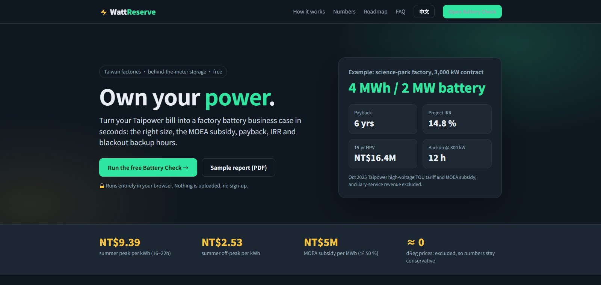
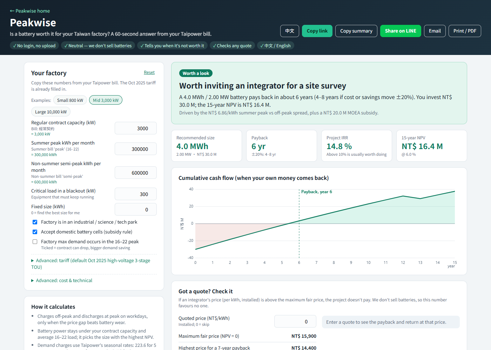

<!-- HERO:START -->
<p align="center">
  <a href="https://juw12.github.io/peakwise/"></a>
</p>

<p align="center">
  <b>Own your power.</b><br>
  <b>Peakwise</b> (峰值) is a free calculator that tells a Taiwan factory in 60 seconds whether on-site battery storage pays back, using the real Taipower tariff and the MOEA subsidy.
</p>

<p align="center">
  <a href="https://juw12.github.io/peakwise/"><b>Try it live</b></a> ·
  <a href="#see-it-in-action">See it in action</a> ·
  <a href="#highlights">Highlights</a> ·
  <a href="https://github.com/juw12">More by juw12</a>
</p>

<p align="center">
  <a href="https://github.com/juw12/peakwise"></a>
  <a href="https://juw12.github.io/peakwise/"></a>
  
  
  
  
</p>

<a id="highlights"></a>
<table>
  <tr>
    <td width="33%" valign="top">
      <b>Free, in your browser</b><br>
      One HTML file. Nothing to install, no sign-up, and your numbers never leave the page.
    </td>
    <td width="33%" valign="top">
      <b>Real Taiwan numbers</b><br>
      Taipower's October 2025 three-stage high-voltage tariff, MOEA storage subsidy and current BESS prices.
    </td>
    <td width="33%" valign="top">
      <b>Check any quote</b><br>
      Shows the maximum fair price per kWh, so you know if an integrator's offer pays. We don't sell batteries.
    </td>
  </tr>
</table>

## See it in action

<p align="center">
  <a href="https://juw12.github.io/peakwise/calculator/"></a><br>
  <sub>Open the calculator at <a href="https://juw12.github.io/peakwise/calculator/">juw12.github.io/peakwise/calculator/</a></sub>
</p>
<!-- HERO:END -->

## About

**Taiwan just made peak electricity expensive. Storage can now pay for itself.**

Since Taipower's October 2025 tariff update, a high-voltage factory pays **NT$9.39/kWh** at the summer
peak and only **NT$2.53/kWh** off-peak. That NT$6.86 spread, plus the MOEA subsidy of up to
NT$5M per MWh, turns a behind-the-meter battery from "nice to have" into a 6-year payback.

Most factory owners never run the numbers because a consultant quote takes weeks. Peakwise takes
your contract capacity, peak load and monthly bill, and tells you in a minute whether a battery is
worth a site visit.

Unlike the calculators run by battery sellers, **Peakwise** needs no login and no meter-data upload, says plainly when a battery is *not* worth it, shows the downside (cost +20 %, savings −20 %, no subsidy), and gives a shareable link you can send to your boss.

## Use the app

1. Open **[juw12.github.io/peakwise](https://juw12.github.io/peakwise/)** (中文 or English, auto-detected; switch any time).
2. Click **Open the calculator** and enter your contract capacity, peak load, monthly kWh and working days.
3. Read the recommended size, payback, IRR and 15-year NPV, then **Print / save PDF**.

A sample Chinese report is in [`docs/sample-report.pdf`](docs/sample-report.pdf).

## How it decides

- **Arbitrage:** charge off-peak and discharge at peak on working days. Summer uses the peak spread and the
  rest of the year uses the half-peak spread. A cycle only runs if its margin beats battery wear.
- **Sizing:** inverter power is capped at the smaller of contract capacity and peak load, and storage is sized for 2 hours.
- **Losses:** 88% round-trip efficiency, 90% usable depth, 2%/yr fade and 1.5%/yr O&M.
- **Money:** NT$12.5M/MWh installed, MOEA subsidy of NT$5M/MWh (≤50%, 1–10 MWh), 15-year life and a 6% discount rate.
- **Excluded on purpose:** Taipower dReg ancillary-service revenue, because clearing prices are near zero after the market filled up.

Reference case: a 2 MWh / 1 MW system from [`model/taiwan_pilot.py`](model/taiwan_pilot.py), with net capex of NT$25M, or NT$15M after the subsidy:

| Tariff | Subsidy | Payback | IRR | NPV (NT$M) |
|---|---|---|---|---|
| 2023 tariff | no | never | — | −21.2 |
| 2023 tariff | yes | 10 yr | 2.8% | −2.5 |
| **Current (Oct 2025)** | no | 10 yr | 4.7% | −1.8 |
| **Current (Oct 2025)** | **yes** | **6 yr** | **14.8%** | **+8.2** |
| Storage TOU (proposed) | yes | 5 yr | 20.6% | +15.6 |

*(Low demand-charge saving case. The model also reports "none" and "high" cases.)*

> This is a screening tool, not an engineering study. Real projects still need a site survey, a
> grid-connection review and a binding integrator quote.

## Roadmap

- [x] Bilingual calculator with Python-parity self-test
- [x] Printable Chinese report
- [ ] Upload a Taipower bill (PDF) to auto-fill the inputs
- [ ] 15-minute load-profile import for exact peak shaving
- [ ] Solar + storage combined case
- [ ] Integrator directory with verified quotes

## Development

```bash
python tests/test_model.py        # model regression tests plus calculator parity check
python model/taiwan_pilot.py      # full scenario table (JSON + chart in model/taiwan_pilot_output/)

# web: no build step; open the file directly, or serve docs/
python -m http.server 8000 -d docs   # then visit http://localhost:8000/calculator/#selftest
```

The `#selftest` hash runs the browser engine on the Python reference case and prints its results as JSON. `tests/test_model.py` checks that they match.

## License

Released under the [MIT License](LICENSE) © 2026 Juwen Lie. Contributions are welcome under the same license; see the [contributing guide](https://github.com/juw12/.github/blob/main/CONTRIBUTING.md) and [Code of Conduct](https://github.com/juw12/.github/blob/main/CODE_OF_CONDUCT.md).
